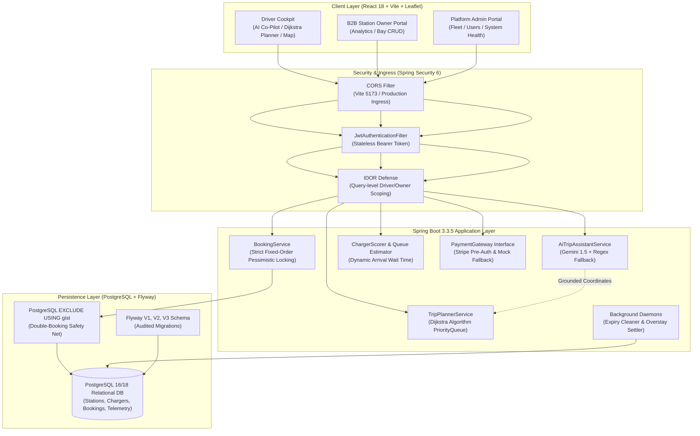

# ⚡ VoltGrid — Intelligent EV Charging & Highway Route Optimization Platform

[]()
[]()
[]()
[]()
[]()
[]()
[]()
[]()
[]()
[]()

> **Production-grade EV Charging SaaS platform engineered for zero double-booking concurrency, Dijkstra-based multi-stop highway trip planning, grounded AI travel co-pilot, and B2B charging station revenue & penalty analytics.**

---

## 🌟 Executive Summary

VoltGrid solves the three hardest problems in electric vehicle charging infrastructure:
1. **The Concurrency & Double-Booking Problem**: Under high demand (flash-booking fast DC bays), multiple drivers book overlapping slots in the same millisecond. Traditional optimistic locking results in cascade retries; naïve pessimistic locking causes deadlocks. VoltGrid combines **ordered dual-entity pessimistic write locks** (`Driver` ➔ `Charger` with a 5-second timeout) with a **PostgreSQL exclusion constraint** (`EXCLUDE USING gist`) as an unbreakable database safety net.
2. **The Sparse Highway Range Problem**: EVs cannot simply calculate Euclidean distances. Range fluctuates wildly based on AC status, speed ($v^2$ aerodynamic drag), terrain elevation, and charger speed limits. VoltGrid models highway corridors as a **state-space graph $(location, socBucket)$** and solves optimal charging stop sequences via a custom **Dijkstra's Algorithm** with a 5% battery safety reserve and effective kW power capping.
3. **The Grounded AI Integration Problem**: Integrating LLMs into transactional platforms often creates prompt injection risks and GPS coordinate hallucinations. VoltGrid implements a **Grounded AI Co-Pilot architecture**: Gemini 1.5 Flash is strictly isolated to natural-language parameter extraction with JSON schema validation, timeout, rate-limiting, and instant regex fallback, while all routing, geocoding, and database operations remain 100% deterministic.

---

## 🏛️ System Architecture



---

## 🔬 Core Engineering Deep-Dives & Trade-Offs

### 1. Concurrency: Zero Double-Booking Guarantee
* **The Challenge**: 20 drivers attempt to book the exact same 120 kW CCS2 bay at the exact same minute.
* **The Solution (Two-Tier Guardrail)**:
  1. **Application-Layer Pessimistic Locking**: `BookingService` acquires `PESSIMISTIC_WRITE` locks in strict chronological order: first on the `Driver` row, then on the `Charger` row, with `spring.datasource.hikari.connection-init-sql=SET lock_timeout = '5s'`. Strict locking order eliminates deadlocks, while the timeout prevents thread pool exhaustion.
  2. **Database-Layer Exclusion Constraint (`Flyway V2`)**:
     ```sql
     CREATE EXTENSION IF NOT EXISTS btree_gist;
     ALTER TABLE bookings ADD CONSTRAINT no_overlapping_active_bookings
     EXCLUDE USING gist (
       charger_id WITH =,
       tstzrange(start_time, end_time) WITH &&
     ) WHERE (status IN ('PENDING_PAYMENT', 'CONFIRMED', 'ACTIVE'));
     ```
  3. **Verification**: Backed by `BookingConcurrencyTest.java` running 20 concurrent threads across 5 rounds — **zero double bookings, exactly 1 succeeds, 19 fail fast with 409 Conflict**.

### 2. Algorithmic Highway Route Optimization (Dijkstra)
* **The Challenge**: Navigate long distances (e.g., Vadodara to Mumbai: ~410 km) across NH48 with multiple DC fast charging hubs while ensuring the vehicle never drops below a 5% battery safety reserve.
* **The Solution**:
  - State space is modeled as a directed graph where state is $(locationNode, socBucket)$.
  - Edge weights represent total elapsed time (driving time + necessary charge duration).
  - Driving energy consumption considers:
    $$E_{drive} = d \times C_{base} \times M_{terrain} \times M_{AC} \times M_{speed}$$
    where $M_{speed}$ captures non-linear aerodynamic drag:
    $$M_{speed} = \begin{cases} 1.15 & \text{if } v > 75 \text{ km/h} \\ 1.05 & \text{if } v > 60 \text{ km/h} \\ 0.95 & \text{otherwise} \end{cases}$$
  - Charging duration accurately caps charging speed by the minimum of the station power and vehicle max DC acceptance rate ($\min(P_{station}, P_{vehicle})$).
  - Unreachable segments trigger an explicit `UnreachableTripException` identifying the specific stranded road leg.

### 3. Grounded AI Trip Co-Pilot (Zero Hallucination Architecture)
* **The Challenge**: Users specify trips using free text like *"I am in Vadodara with 22% battery, AC on, driving to Mumbai at 80 km/h"*. LLMs notoriously hallucinate nonexistent GPS coordinates, invent imaginary charging stations, or get hijacked via prompt injection.
* **The Solution**:
  - **Strict JSON Schema & Isolation**: Gemini 1.5 Flash is invoked solely as a text-to-JSON extractor with a strict JSON schema (`originCity`, `destinationCity`, `currentBatteryPercent`, `acOn`, `speedKmh`, `terrain`).
  - **Authoritative Geocoding Grounding**: Extracted city names are resolved against an authoritative canonical Indian city coordinates lookup (`IndianCityCoordinates.java`). The LLM never provides coordinates.
  - **Defense-in-Depth Guardrails**: 400-character input sanitization, 4-second timeout, 60-second circuit-breaker cooldown, and a **100% deterministic regex fallback parser** that triggers if the API key is missing or external calls fail.
  - **Zero Database Access**: The AI layer has read-only DTO contracts and cannot directly invoke repository write methods.

### 4. Security & IDOR Query-Level Scoping
* Client payloads containing `ownerId` or `driverId` are ignored.
* All queries enforce tenant isolation at the SQL query level:
  - Owner endpoints use `stationRepository.findByIdAndOwnerId(stationId, authenticatedUser.getId())`.
  - Driver vehicle operations use `vehicleRepository.findByIdAndDriverIdAndActiveTrue(...)`.
  - Active booking cancellations enforce `booking.getDriver().getId().equals(user.id())`.

### 5. Financial Settlement, Idempotency & Overstay Penalties
* **Idempotent Stripe Integration**: Payments utilize client-generated idempotency keys (`idempotency_key` unique index in DB) preventing accidental duplicate charges on network retries.
* **Overstay Penalty Settler (@Scheduled)**: Idle cars blocking chargers are charged ₹10/minute after a 10-minute grace period following `chargeCompletedAt`.
* **Expired Hold Cleanup (@Scheduled)**: Unpaid `PENDING_PAYMENT` holds automatically expire after 5 minutes, liberating the charger bay for other waiting drivers.

---

## 📊 Comprehensive Test Suite (18/18 Passing)

The platform is fortified with unit, integration, concurrency, and security tests (`.\mvnw.cmd test`):

| Test Suite | Tests | Key Invariant Verified |
| :--- | :---: | :--- |
| `AiTripAssistantTest` | 4 | Natural language parameter extraction, coordinate grounding, boundary clamping, and auto-planning integration |
| `BookingConcurrencyTest` | 3 | 20 simultaneous threads booking same charger slot: 0 double bookings; fixed-order lock timeout |
| `HighwayTripPlannerTest` | 4 | Dijkstra multi-stop sequence, battery reserve safety margin, aerodynamic speed consumption, unreachable trip exception |
| `PaymentAndSessionLifecycleTest` | 4 | Pre-authorization hold, Stripe webhook transition, session simulator lifecycle (start ➔ complete ➔ plug-out), overstay penalty settlement |
| `OwnerAnalyticsTest` | 2 | B2B revenue and overstay penalty aggregation, station utilization %, busiest hours analytics |
| `VoltgridApplicationTests` | 1 | Spring Boot 3.3.5 context initialization, Flyway migration integrity |

---

## 🚀 Quickstart & Local Setup

### Prerequisites
- **Java 21** (JDK 21+)
- **Node.js 18+** & npm
- **PostgreSQL 16+** (running on `localhost:5432`)
- **Docker & Docker Compose** (optional for containerized deployment)

### 1. Database Setup
Create the PostgreSQL database:
```sql
CREATE DATABASE voltgrid_db;
```
Configure credentials in `src/main/resources/application.properties` (or set environment variables `DB_USERNAME` and `DB_PASSWORD`). Flyway will automatically run all migrations on startup.

### 2. Run Backend (Spring Boot)
```powershell
# Run all automated tests
.\mvnw.cmd test

# Start the Spring Boot application
.\mvnw.cmd spring-boot:run
```
The backend starts on `http://localhost:8080`.
- **Interactive Swagger UI**: [http://localhost:8080/swagger-ui.html](http://localhost:8080/swagger-ui.html)
- **OpenAPI 3.0 Docs**: [http://localhost:8080/v3/api-docs](http://localhost:8080/v3/api-docs)

### 3. Run Frontend (React + Vite)
```powershell
cd frontend
npm install
npm run dev
```
Open your browser at `http://localhost:5173`.

### 4. Docker Compose (One-Click Production Setup)
```bash
docker-compose up --build -d
```
Spins up PostgreSQL container (`port 5432`) and multi-stage containerized Spring Boot backend (`port 8080`).

---

## 🔑 Pre-Seeded Demonstration Accounts

Upon startup, the `AdminSeeder` and `NetworkDataSeeder` automatically configure demo accounts and 12+ realistic EV charging hubs across Vadodara, Ahmedabad, Pune, and Mumbai:

| Role | Email | Password | Features Accessible |
| :--- | :--- | :--- | :--- |
| **Admin** | `admin@voltgrid.com` | `Admin12345!` | Platform Overview, User Management, Global Station Fleet |
| **Driver** | `driver@voltgrid.com` | `Driver12345!` | Grounded AI Co-Pilot, Dijkstra Highway Planner, Interactive Map, Session Simulator |
| **Owner** | `owner@voltgrid.com` | `Owner12345!` | Station & Charger CRUD, Status Toggles, Revenue & Penalty Analytics |

---

## 🛠️ Technology Stack

* **Backend**: Java 21, Spring Boot 3.3.5, Spring Security 6 (JWT Bearer), Spring Data JPA / Hibernate 6, Flyway Migrations.
* **Algorithms**: Custom Dijkstra Shortest-Path Graph Solver (`PriorityQueue`), Non-Linear Aerodynamic Consumption Modeling.
* **AI & NLP**: Google Gemini 1.5 Flash via Spring `RestClient`, Strict JSON Schemas, Circuit Breaker, Deterministic Regex Fallback Engine.
* **Database**: PostgreSQL 16/18 with `btree_gist` Extension and GiST Exclusion Constraints.
* **Frontend**: React 18, Vite 6, Tailwind CSS v3, Leaflet & React-Leaflet, Lucide Icons, Glassmorphism UI.
* **CI/CD & DevOps**: Docker Multi-Stage Build, Docker Compose, GitHub Actions CI.

---

## 📄 License
VoltGrid is distributed under the MIT License. Built with ❤️ for the future of sustainable electric mobility.
